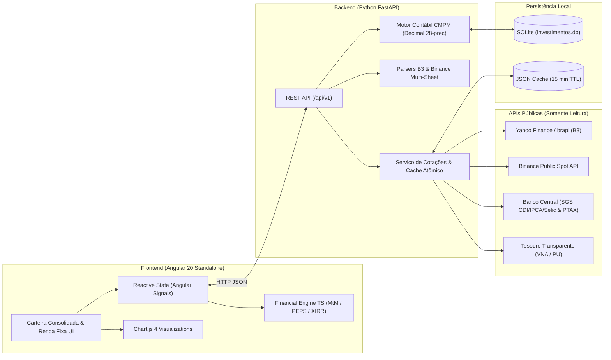

# 📊 Investidor Local

> **Plataforma Local-First de Gestão Patrimonial, Contabilidade Fiscal (IRPF) e Marcação a Mercado**  
> Consolide **Ações, FIIs, Renda Fixa (Tesouro Direto, CDB, LCI, LCA) e Criptoativos (Binance & Autocustódia)** com precisão contábil de 8 casas decimais e 100% de privacidade no seu próprio computador.


---

## 🎯 Sobre o Projeto

O **Investidor Local** nasceu da necessidade de ter um consolidador de carteira que não apenas mostre saldos superficiais, mas que resolva os problemas reais e complexos da vida financeira do investidor brasileiro:

1. **Privacidade Absoluta (*Local-First / Self-Hosted*):** Seus extratos da B3, relatórios da Binance e banco de dados (`SQLite`) ficam exclusivamente na sua máquina. Nenhuma chave de API privada ou dado sensível é enviado para servidores de terceiros.
2. **Rigor Contábil e Fiscal (Padrão Receita Federal):** Todos os cálculos monetários e de estoque utilizam aritmética `Decimal` de alta precisão (28 dígitos significativos), eliminando erros de arredondamento de ponto flutuante (`IEEE 754`).
3. **Ingestão Inteligente do Mundo Real:** Suporte nativo às peculiaridades das planilhas da **B3** (aluguel de ações BTC, subscrições, desdobros, grupamentos, portabilidade sem preço médio, vencimentos de CDBs) e da **Binance** (ordens a mercado, moeda-ponte `USDT`, *Simple Earn / Staking*, *Airdrops* e cruzamento com *Cold Wallets* de autocustódia).

---

## ✨ Principais Funcionalidades

### 📈 1. Renda Variável (Ações & FIIs — B3)
- **Custo Médio Ponderado Móvel (CMPM):** Apuração exata do Preço Médio Contábil, custo total investido e lucro/prejuízo realizado em vendas parciais ou totais.
- **Proventos & Preço Médio Ajustado:** Registro automático e manual de *Dividendos*, *JCP*, *Rendimentos de FIIs*, *Restituição de Capital* e *Taxas de Aluguel BTC*, calculando o **Dividendo por Ação**, o **PM Ajustado** e o **Yield on Cost (YoC %)** individual e da carteira.
- **Filtro Determinístico de Empréstimo BTC (Aluguel de Ações):** Distingue automaticamente liquidações de aluguel de ações (*Empréstimo BTC*) de compras e vendas reais na bolsa, evitando distorções de saldo mesmo quando o investidor compra ações enquanto possui lotes alugados.
- **Eventos Corporativos e Sucessão de Tickers:** Processamento automático de *Desdobro*, *Grupamento*, *Bonificação*, *Exercício de Subscrição*, *Fração em Ativos*, *Leilão de Fração* e conversão histórica de tickers (ex: `TRPL4` $\rightarrow$ `ISAE4`).
- **Resolução de Transferências de Custódia Pendentes:** Identifica lotes vindos de portabilidade/transferência sem custo informado (`PU = R$ 0,00`) sem diluir falsamente o Preço Médio, oferecendo **3 modos de resolução**:
  - **Modo A:** Informar o Preço Unitário original na data da transferência;
  - **Modo B (Engenharia Reversa):** Informar o Preço Médio consolidado atual da corretora para cálculo reverso automático do lote transferido;
  - **Modo C (1 Clique):** Busca automática da cotação histórica de fechamento na B3/Yahoo Finance na data exata da transferência (desajustando splits posteriores).

### 🏛️ 2. Renda Fixa & Simulador de Marcação a Mercado (MtM)
- **Motor PEPS (FIFO) Fiscalmente Preciso:** Baixa automática dos lotes mais antigos primeiro nos resgates parciais, aplicando a tabela regressiva de **IR (22,5% a 15%)** e **IOF (primeiros 29 dias)** lote a lote, com suporte a títulos isentos (**LCI / LCA**).
- **Precificação Polimórfica Multi-Instrumentos:**
  - **Tesouro RendA+ (`NTN-B1`):** Precificação exata com fluxo descontado das 240 parcelas mensais de amortização corrigidas pelo IPCA e calibração com o VNA/PU oficial do Tesouro Transparente;
  - **Pós-Fixados em CDI (`CDB`, `LCI`, `LCA`):** Capitalização diária na base 252 dias úteis sobre a curva do CDI (SGS Banco Central);
  - **Prefixados (`LTN`) e IPCA+ Bullet (`NTN-B Principal`).**
- **Análise Avançada em 5 Abas Dedicadas:**
  1. **Posição PEPS (Carteira Consolidada ou Por Título):** Tabela unificada de lotes, comparativo *Saldo Bruto* vs. *Líquido Real (pós-IR/IOF/B3)* e **TIR Consolidada (XIRR)**;
  2. **Simulador Interativo (60 FPS):** Simulação em tempo real de choques na taxa de juros, data de venda e inflação, decompondo o resultado entre **Ganho de Carrego (Curva)** e **Ganho/Perda de Marcação a Mercado (MtM)**;
  3. **Projeção (5 Curvas):** Trajetória comparativa até o vencimento (*Cenário Alvo*, *Curva de Carrego*, *100% CDI*, *Otimista* e *Pessimista*) com toggles *Líquido/Bruto* e *Nominal/Real*;
  4. **Matriz de Sensibilidade (Heatmap):** Matriz de cenários cruzando variações de taxa de juros vs. horizonte temporal;
  5. **Premissas & Sincronização Macro:** Integração automática com as séries históricas do **Banco Central (Selic, CDI e IPCA)** e preços do **Tesouro Direto**.

### ₿ 3. Criptoativos & Ecossistema Binance (Spot + Earn + Autocustódia)
- **Ingestão Multi-Aba da Binance (`user_operation_detail.xlsx`):**
  - Lê de forma integrada as abas *Spot Order History* (incluindo ordens `Market` pelo `Average Price`), *OTC Trading*, *Fiat Deposit History (PIX)*, *Binance Pay*, *Binance Card*, *Deposit History*, *Withdrawal History* e *Account Balance (Earn)*.
- **Moeda-Ponte Cambial (`USDTBRL` & PTAX BCB):** Constrói a linha do tempo do custo efetivo em Reais de cada dólar (`USDT`) adquirido via PIX. Caso uma operação em par dólar (`BTCUSDT`, `SOLUSDT`, `ETHUSDT`, etc.) não possua compra prévia de `USDT`, consulta automaticamente a **PTAX de Venda oficial do Banco Central** da data da operação (regra da Receita Federal / IN 1.888).
- **Reconciliação Física de 8 Casas Decimais:** Cruza compras/vendas, taxas de rede/trade e rendimentos de staking para reconciliar a custódia exata dividida entre:
  - `🔐 Autocustódia Externa (Cold Wallet / Saques Líquidos)`
  - `🟡 Binance Earn (Staking em Corretora)`
- **Higienização de Poeira Residual (*Dust Filter*):** Moedas recebidas via *Airdrop / Launchpool* e 100% vendidas que deixam frações invendáveis no Earn (valor residual `< US$ 0,50`) são automaticamente higienizadas do estoque ativo e mantidas em **Posições Encerradas** com `+100% (Airdrop)` de lucro realizado.
- **Tripla Moeda em Tempo Real (`R$`, `US$` e `₿`):** Cotações ao vivo via API pública da Binance (`*USDT` $\times$ `USDTBRL`), exibindo simultaneamente o Preço Médio, a Cotação e o Patrimônio em **Reais (BRL)**, **Dólares (USD)** e **Equivalência em Bitcoin (BTC)**.
- **Declaração IRPF em 1 Clique:** Badges fiscais **📋 IRPF 08/01** (Bitcoin) e **📋 IRPF 08/02** (Altcoins) que copiam para a área de transferência o texto padrão da ficha de *Bens e Direitos* da Receita Federal com quantidades exatas em autocustódia, corretora e custo de aquisição em Reais.

### 📊 4. Dashboard, Gráficos e Posições Encerradas
- **6 KPI Cards Dinâmicos:** *Montante Aportado (Custo Fiscal)*, *Patrimônio Atual a Mercado*, *Valorização da Cota (Aberto)*, *Proventos / Rendimentos Recebidos (EARN)*, *Retorno Total Acumulado (Cota + Proventos + Vendas)* e *Lucro/Prejuízo Realizado*.
- **3 Gráficos Interativos (Chart.js):**
  - *Alocação da Carteira* (Rosca por Classe de Ativo ou por Setor);
  - *Concentração Top 12 Ativos* (Barras Horizontais com peso % no patrimônio);
  - *Top 10 Geradores de Renda Passiva* (Total recebido em R$ vs. *Yield on Cost %*).
- **Alternador `🟢 Em Custódia (Ativas)` vs. `🏁 Posições Encerradas (Já Vendidas)`:** Rastreia todo o histórico de ativos já liquidados (Ações, FIIs, CDBs vencidos/resgatados e trades de Cripto), preservando o Custo Histórico, Valor Total de Venda, Lucro Realizado (R$ e %) e Proventos gerados.

---

## 🏗️ Arquitetura e Stack Tecnológica



### Tecnologias Utilizadas
- **Backend:** Python 3.11+, FastAPI, SQLAlchemy 2.0, Pydantic v2, Pandas, OpenPyXL, HTTPX (async), Pytest.
- **Frontend:** Angular 20 (Standalone Components, Signals, Control Flow), TypeScript 5.9, Chart.js 4.5, RxJS 7.8, SCSS, Karma + Jasmine.
- **Banco de Dados:** SQLite 3 com migrações defensivas automáticas no *startup* e backups preventivos.

---

## 📂 Estrutura do Repositório

```text
InvestidorLocal/
├── backend/
│   ├── app/
│   │   ├── api/v1/endpoints/      # Rotas REST (carteira, ativos, transacoes, importacao, renda_fixa)
│   │   ├── core/                  # Configurações e variáveis de ambiente
│   │   ├── db/                    # Sessão SQLAlchemy e migrações defensivas idempotentes
│   │   ├── models/                # Entidades ORM (Carteira, Ativo, Transacao, PosicaoConsolidada, DetalhesRendaFixa)
│   │   ├── schemas/               # Contratos Pydantic v2 com serialização Decimal precisa
│   │   ├── services/
│   │   │   ├── ingestion/         # Parsers B3 (Negociação e Movimentação) e Binance (Multi-abas)
│   │   │   ├── renda_fixa/        # Extrator de lotes PEPS e integração BCB / Tesouro Direto
│   │   │   ├── cotacoes.py        # Cotações assíncronas B3, Binance Spot, Curva CDI e Tesouro
│   │   │   └── portfolio.py       # Motor contábil CMPM, proventos, lucro realizado e engenharia reversa de PM
│   │   └── main.py                # Entrypoint FastAPI + CORS + Lifespan
│   ├── tests/                     # 96 testes automatizados (pytest)
│   └── requirements.txt
├── frontend/
│   ├── src/app/
│   │   ├── core/
│   │   │   ├── financial-engine/  # Motor matemático TS puro (RendA+, CDI, Bullet, IR/IOF, XIRR, Projeções)
│   │   │   ├── models/            # Interfaces TypeScript e DTOs
│   │   │   └── services/          # Serviços HTTP (CarteiraService, RendaFixaApiService)
│   │   └── pages/
│   │       ├── carteira/          # Dashboard Consolidado, Store Signals, Gráficos Chart.js e 3 Modais CRUD
│   │       ├── renda-fixa/        # Módulo avançado de Renda Fixa (5 abas: PEPS, Simulador, Projeção, Heatmap, Premissas)
│   │       └── importacao/        # Tela de upload de planilhas B3 e Binance
│   └── package.json               # 246 testes unitários (Karma / Jasmine)
└── .gitignore                     # Proteção estrita contra envio de bancos (.db) e planilhas pessoais (.xlsx)
```

---

## 🚀 Como Executar Localmente

### Pré-requisitos
- **Python 3.11+** instalado
- **Node.js 20+** e **npm** instalados

### 1. Clonar o Repositório
```bash
git clone https://github.com/EnricoNSilva/InvestidorLocal.git
cd InvestidorLocal
```

### 2. Iniciar o Backend (FastAPI)
Na raiz do projeto, crie o ambiente virtual, instale as dependências e inicie o servidor:

```powershell
# Windows (PowerShell)
python -m venv .venv
.\.venv\Scripts\Activate.ps1
pip install -r backend/requirements.txt

# Iniciar a API na porta 8000
cd backend
python -m uvicorn app.main:app --reload --port 8000
```
> 💡 O banco de dados SQLite (`backend/investimentos.db`) e todas as tabelas serão criados automaticamente na primeira execução.  
> 📄 **Documentação Swagger / OpenAPI:** disponível em `http://localhost:8000/api/v1/docs`

### 3. Iniciar o Frontend (Angular)
Em um novo terminal, instale os pacotes do frontend e rode o servidor de desenvolvimento:

```bash
cd frontend
npm install
npm start
```
> 🌐 Acesse a aplicação em **`http://localhost:4200`**

---

## 📥 Guia de Importação de Planilhas

Na barra superior da aplicação, acesse **Importar Planilhas** (`/importacao`) e escolha a carteira de destino:

1. **Planilhas de Movimentação da B3 (`.xlsx`):**
   - Exporte no portal [Área do Investidor B3](https://www.investidor.b3.com.br/) em *Extratos $\rightarrow$ Movimentação* (pode selecionar múltiplos arquivos anuais de uma só vez, ex: `2022` a `2026`).
   - O sistema ordena cronologicamente todas as operações, processa compras, vendas, proventos, bonificações, desdobros, filtra aluguéis BTC e cadastra automaticamente seus CDBs e títulos do Tesouro Direto.
2. **Planilhas de Negociação da B3 (`.xlsx`):**
   - Exporte em *Extratos $\rightarrow$ Negociação* para importar ordens de compra e venda de Ações e FIIs.
3. **Relatório Completo da Binance (`.xlsx`):**
   - Exporte o relatório `user_operation_detail.xlsx` (ou planilha com a aba `Order History` / `Spot Order History`) na Binance.
   - O parser processará automaticamente seus aportes PIX, compras/vendas em BRL e USDT, rendimentos de Staking (Earn) e saques para autocustódia.

---

## 🧪 Executando os Testes Automatizados

O projeto conta com **342 testes automatizados** cobrindo as regras contábeis, parsers de ingestão, motor matemático de marcação a mercado (*Golden Master*) e componentes de interface:

### Backend (`pytest` — 96 testes)
```powershell
.\.venv\Scripts\python.exe -m pytest -q
```

### Frontend (`Karma / ChromeHeadless` — 246 testes)
```bash
cd frontend
npm test -- --watch=false --browsers=ChromeHeadless
```

### Build de Produção
```bash
cd frontend
npx ng build
```

---

## 🔒 Segurança e Privacidade dos Dados

Este repositório foi projetado para ser compartilhado publicamente com segurança:
- O arquivo [`.gitignore`](.gitignore) bloqueia qualquer arquivo de banco de dados (`*.db`, `*.sqlite`, `*.bak`), planilhas financeiras (`*.xlsx`, `*.xls`, `*.csv`), caches de cotações (`backend/data/`) e variáveis de ambiente (`.env`).
- Todos os testes automatizados utilizam bancos SQLite isolados em memória (`:memory:`) e dados fictícios gerados dinamicamente em tempo de teste.

---

## 📝 Licença

Distribuído sob a licença **MIT**. Sinta-se livre para utilizar, estudar e adaptar para a gestão da sua própria carteira!
